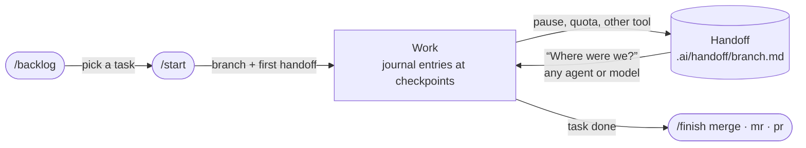

<div align="center">

# SRG SSR Agent Skills

**Agent Skills and Claude Code plugins that make AI coding agents work the way your project needs _right now_,<br/>and let any agent, model or human pick up exactly where the last one stopped.**

[](https://agentskills.io)
[](#install)
[](plugins/project-phase/)
[](plugins/work-journal/)
[](#does-it-make-a-difference)
[](https://github.com/SRGSSR/agent-skills/actions/workflows/checks.yml)
[](LICENSE)

Works with **Claude Code**, **Codex**, **Cursor**, **Gemini CLI**, **GitHub Copilot**, **OpenCode** and other tools that read `AGENTS.md`

[Install](#install) · [project-phase](#project-phase) · [work-journal](#work-journal) · [Evals](#does-it-make-a-difference) · [Contributing](#contributing)

</div>

---

| Plugin | What it does | Skills |
|---|---|---|
| 🧭 [**project‑phase**](plugins/project-phase/) | The agent works the way the project's lifecycle phase needs: prototype, production, maintenance, ... | `project-phase` |
| 📓 [**work‑journal**](plugins/work-journal/) | A journal and a handoff per branch, so anyone can pause and resume with zero context; tasks and branch workflow | `work-journal`, `backlog`, `start`, `finish` |

## Install

### Claude Code

```bash
claude plugin marketplace add SRGSSR/agent-skills
claude plugin install project-phase@srgssr
claude plugin install work-journal@srgssr
```

Install one or both: they work independently.

### Any agent (Codex, Cursor, Gemini CLI, GitHub Copilot, OpenCode, ...)

With [`skills`](https://github.com/vercel-labs/skills), all skills or only some:

```bash
npx skills add SRGSSR/agent-skills
```

```bash
npx skills add SRGSSR/agent-skills --skill project-phase
```

Or copy the skill folders (`plugins/<plugin>/skills/<skill>/`) into your tool's skills folder (`.agents/skills/` is read by most tools; Claude Code uses `.claude/skills/`).

<details>
<summary><b>Tool notes</b> (Claude Code with a <code>CLAUDE.md</code>, Gemini CLI)</summary>

Both plugins write a short block into `AGENTS.md`, the instruction file most agent tools load on every task.

- **Claude Code** reads `AGENTS.md` only when there is no `CLAUDE.md`. Setup adds `@AGENTS.md` to an existing `CLAUDE.md`.
- **Gemini CLI** reads `GEMINI.md` by default. Add `AGENTS.md` to `context.fileName` in its settings.

</details>

## Plugins

### project-phase


AI agents treat every project the same way: on a weekend prototype they scaffold layers, CI and a test suite nobody asked for; on a system that must not regress they "clean up" the code next to the fix. Neither is wrong in itself; it's wrong **for the phase**.

`project-phase` makes the phase explicit and gives the agent a short contract for it. **Same agent, same model, same request**, only the phase in `AGENTS.md` changes:

> *"Fix the rounding bug in `applyDiscount`."*

| | 🧪&nbsp;`prototype` | 🚀&nbsp;`production` | 🛡️&nbsp;`maintenance` |
|---|---|---|---|
| **Does** | Fixes it the simplest way that works; rewriting the function is fine | Fixes it following the existing patterns and adds a regression test | Reproduces it with a failing test first, then makes the smallest diff that fixes it |
| **Doesn't** | Add a test suite, CI, or a closing list of "next steps you should consider" | Mix a refactor into the fix, or break an API "because it's cleaner" | Rename, reformat, bump dependencies, or change another caller with the same bug: it notes that one in `.ai/debt.md` |
| **Reports** | One to three lines | What changed, tests, risks, up to 3 structural observations | What changed, why it's safe, what it noticed and left alone |

Six phases from `explore` to `sunset`, sets to pick from, area overrides, transition checklists and a one-line tech-debt register. **[Full docs and guides →](plugins/project-phase/)**

### work-journal


Work with agents gets interrupted all the time: the session ends, the context fills up, the quota runs out, you switch tool. `work-journal` keeps a terse journal and a handoff per branch in the repo, so whatever matters is written down where the next agent will find it.

```text
Mon 17:40   you → Claude Code   "Let's stop here, I'll continue tomorrow."
            ✍️  .ai/handoff/feature-csv-export.md   goal · status · next steps · dead ends

Tue 09:05   you → Codex         "Where were we?"
            📖  reads the handoff and the last journal entries, checks them against git,
                says what it's resuming, starts on the next step
```

It ships with `/backlog` (task files, GitHub or GitLab issues, Jira), `/start` and `/finish`, so one branch goes from task to merge across as many sessions, tools and people as it takes:



**[Full docs and guides →](plugins/work-journal/)**

### Better together

Each plugin works on its own. Together, `project-phase` says what the work should look like in each phase, and the plan for the next one in `.ai/debt.md`; `work-journal` keeps track of that work across sessions, tools and people, and logs phase changes in the journal.

## Does it make a difference?

Every behavior change is checked with [evals](evals/): fixture repos with real git history, each case run on the same repo **with and without** the skills, graded by a script.

The last full run, on 2026-11-03 (skills at 0.4, 15 cases, Claude Sonnet 5.5):

| | Checks passed |
|---|:-:|
| ✅ With the skills | **126 / 126** |
| ➖ Without | 104 / 126 |

On 5 of those 15 cases the model already got everything right on its own; they stay as regression tests. Where the skills made the difference, from this and later runs:

- **Moving a prototype to stabilize:** with the skill, the gaps went into `.ai/debt.md` as `must`, `soon` and `later` items and no code was touched; without, vaguer items and no priorities.
- **A repo with no phase recorded** (with `project-phase: ask` in the global instructions): with the skill, the agent asked, stated the phase it assumed from tags, CI and deploy files, and recorded nothing until answered.
- **"Create the team file":** with the skill, the agent warned that the file holds personal data and looked no one up before you agreed; without, it created the file right away.

The suite has since grown to 44 cases, run as each feature lands.

## Guides

| Plugin | Guides |
|---|---|
| project-phase | [Getting started](plugins/project-phase/docs/getting-started.md) · [Changing phase](plugins/project-phase/docs/phase-changes.md) |
| work-journal | [Getting started](plugins/work-journal/docs/getting-started.md) · [Teams and long-lived projects](plugins/work-journal/docs/teams.md) · [Backlog commands](plugins/work-journal/docs/teams.md#backlog-commands) |

Why the skills work the way they do, and what was discarded: [Design notes](docs/design.md).

## Related work

- [Cline Memory Bank](https://docs.cline.bot/prompting/cline-memory-bank): project context files read at every task start.
- [andrej-karpathy-skills](https://github.com/forrestchang/andrej-karpathy-skills): a fixed set of anti-over-engineering guidelines. `project-phase` makes the rigor depend on the phase instead.
- [agent-lifecycle-skills](https://github.com/tosclone1/agent-lifecycle-skills): lifecycle stages for Codex.
- Handoff skills such as [mattpocock/skills handoff](https://github.com/mattpocock/skills/tree/main/skills/productivity/handoff) and [claude-handoff](https://github.com/REMvisual/claude-handoff).

## Contributing

Issues and pull requests are welcome, especially reports of cases where the agent misread a phase. Please include the phase, the request and what the agent did.

Each plugin lives in `plugins/<plugin>/`: its skills under `skills/`, its guides under `docs/`, a README, and `.claude-plugin/plugin.json` with its version; `.claude-plugin/marketplace.json` lists the plugins. This repo is developed with its own skills: see its [`AGENTS.md`](AGENTS.md) and [`.ai/`](.ai/).

Behavior changes are checked with evals in [`evals/`](evals/): realistic fixture repos with git history (`evals/fixtures/build.sh`), test cases in `evals.json`, a programmatic grader (`grade.mjs`), and the run layout and prompt in `run-prompt.md`. Each case runs with and without the skills on the same repo. Every push and pull request also runs the [checks](.github/workflows/checks.yml): plugin validation, strict YAML in each `SKILL.md`, description length and links. Before changing how a skill behaves, read the [design notes](docs/design.md): most alternatives have been tried.

## License

[MIT](LICENSE). Started by people at [SRG SSR](https://www.srgssr.ch), the Swiss public broadcaster.
