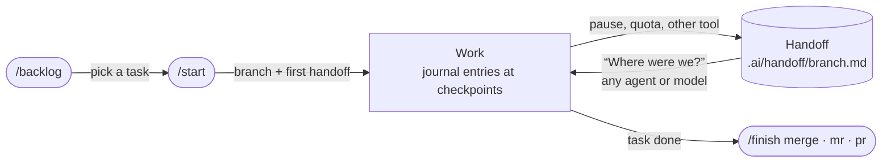

# work-journal

Keeps a terse work journal and a handoff per branch in the repo, so any agent, model or human can pause and resume the work with zero context. Ships with `/backlog`, `/start` and `/finish`. Part of [SRG SSR Agent Skills](https://github.com/SRGSSR/agent-skills).

## Install

```bash
claude plugin marketplace add SRGSSR/agent-skills
claude plugin install work-journal@srgssr
```

Other agents (Codex, Cursor, Gemini CLI, GitHub Copilot, OpenCode, ...):

```bash
npx skills add SRGSSR/agent-skills --skill work-journal backlog start finish
```

Then work as usual. The journal sets itself up the first time it's needed, or ask for it: *"Set up the work journal."*

## Why

Work with AI agents gets interrupted all the time: sessions end, context fills up, quotas run out, you switch tools. Whatever was not written down is lost, and the next agent rediscovers it the expensive way or repeats the same dead ends. `work-journal` makes sure what matters is written down where the next agent will find it.

## How it works

```text
Mon 17:40   you → Claude Code   "Let's stop here, I'll continue tomorrow."
            ✍️  .ai/handoff/feature-csv-export.md   goal · status · next steps · dead ends

Tue 09:05   you → Codex         "Where were we?"
            📖  reads the handoff and the last journal entries, checks them against git,
                says what it's resuming, starts on the next step
```

Setup writes a short block into `AGENTS.md`, the instruction file most agent tools load on every task, so the protocol holds even when the skill itself is not loaded, and across tools. State lives in plain Markdown under `.ai/`:

```
AGENTS.md                 ← journal block (about 9 lines), loaded on every task
.ai/
├── team.md               ← people's handles on each system, roles and nicknames (only if you ask for it)
├── handoff/
│   └── feature-x.md      ← current state of one branch: goal, status, next steps, open questions
└── journal/
    └── 2026-10-02.md     ← append-only log shared by all branches: what was done, decisions, dead ends
```

`.ai/` is meant to be committed, so the handoff travels across machines and people; for `.ai/team.md` you choose when you create it. You can ignore `.ai/journal/` if you prefer to keep the log private.

<details>
<summary><b>What a handoff looks like</b></summary>

```markdown
# Handoff
Updated: 2026-10-02 17:40 · by: claude-code/claude-opus-5-5
Branch: feature/csv-export · Base: develop · Last commit: a1b2c3d · Uncommitted: `src/export.js` (work in progress)

## Goal
Users can export the item list as CSV from the list page. Done when the button downloads a file that opens correctly in Excel.

## Status
- [x] `GET /items.csv` endpoint, streams rows
- [~] Excel compatibility: UTF-8 BOM added, separator still wrong for Swiss locale
- [ ] Download button in `views/items.ejs`

## Next steps
1. In `src/export.js`, make the separator configurable (`;` for de-CH); see the comment at `formatRow`.
2. Add the button to `views/items.ejs` next to "New item".

## Dead ends
- `json2csv`: breaks on nested fields. Don't retry without flattening first.

## Open questions
- For the user: should archived items be included?
```

</details>

**Teams and long-lived projects.** One handoff per branch, so people on different branches never overwrite each other's state; the journal is shared and merges without conflicts (`merge=union`); resuming reads only the newest journal file, so the cost doesn't grow over the years. Details: [Teams and long-lived projects](docs/teams.md).

**Design decisions and tasks.** What outlives a branch goes where people look, not in `.ai/`: **design decisions** (an existing ADR folder, `docs/design/`, `docs/decisions.md`, or code comments and the README) and **tasks** (`docs/backlog/` with one file per open task, GitLab or GitHub issues through `glab` or `gh`, Jira through `acli` or the Atlassian connector, another tracker through a connector, or none). Setup chooses both and names them in the block; `/backlog` lists, filters, creates, edits, comments on and closes tasks, and finds people by nickname through `.ai/team.md`.

## Skills and commands

| Skill | Commands | Does |
|---|---|---|
| [`work-journal`](skills/work-journal/SKILL.md) | `/work-journal`, `setup`, `on`, `off`, `help` | Journal entries at checkpoints, per-branch handoff, resume |
| [`backlog`](skills/backlog/SKILL.md) | `/backlog`, `new`, `edit`, `comment`, `close`, `filter`, `help` | Open tasks in task files, GitHub or GitLab issues, or Jira; what to pick up next |
| [`start`](skills/start/SKILL.md) | `/start <task or name> [context]` | Opens a branch for a task (git flow if the repo uses it) with its first handoff, offers to assign the task to you |
| [`finish`](skills/finish/SKILL.md) | `/finish merge`, `merge-request` (`mr`), `pull-request` (`pr`), `help` | Checks that the work is done and documented, then merges or prepares the merge or pull request |



## What to say

Talk to your agent normally, in any language:

| You say | The agent |
|---|---|
| "Set up the work journal." or `/work-journal setup` | Adds the journal block, asks where design decisions and tasks go |
| "Let's stop here, I'll continue tomorrow." | Writes the branch's handoff |
| "Where were we?" or `/work-journal` | Reads the handoff, checks it against git, continues |
| "What should I work on next?" or `/backlog` | Lists the open tasks (folder, GitLab or GitHub issues, Jira): yours, unassigned, others; suggests one |
| `/backlog new <what>`, `/backlog edit <task> <change>`, `/backlog comment <task> <text>`, `/backlog close <task>` | Creates, edits, comments on or closes a task; issues only after your confirmation |
| `/backlog filter <condition>`, `/backlog help` | Lists only the tasks that match (parent, epic, label, sprint, person, JQL...); shows the commands |
| "Who could take PODCAST-57?" | Suggests people whose Roles in `.ai/team.md` match the task, with their open tasks; assigns only if you ask |
| "Assign #42 to Simo." | Finds Simo's handle for that tracker in `.ai/team.md` (or in the tracker, asking if unclear), shows the change, assigns after your confirmation |
| "Create the team file." | Warns that `.ai/team.md` holds personal data and asks whether to go on; then fills it from git and the tracker, shows it, and asks whether to commit it or keep it ignored by git. Never proposed unasked |
| "Let's start on PODCAST-42." or `/start PODCAST-42` | Opens `feature/PODCAST-42-<slug>` from the development branch (git flow if used), writes the handoff with the task's goal, offers to assign the task to you and mark it in progress |
| `/finish merge`, `mr` or `pr`, optionally followed by instructions (`/finish pr as a draft`) | Checks commits, build and tests, handoff, docs, decisions and follow-ups; stops and asks if something is missing; otherwise merges or prepares the merge or pull request |
| `/work-journal setup` on a project already set up | Shows the current choices, proposes only what the repo signals suggest changing (task place, filter), changes what you confirm |
| `/work-journal off`, `/work-journal on` | Replaces the block with an off marker and keeps `.ai/`, or restores the block |

An example for each `/backlog` command, and what a listing looks like: [Backlog commands](docs/teams.md#backlog-commands).

## Guides

| Situation | Guide |
|---|---|
| Setting it up in a new repo or one with history; pausing, resuming and finishing work | [Getting started](docs/getting-started.md) |
| Several people, many branches, trackers, a project that lasts years | [Teams and long-lived projects](docs/teams.md) |

## Cost

The always-loaded part is the `AGENTS.md` block: about 9 lines. Journal entries are 2 to 6 lines at checkpoints, and resuming reads only the branch's handoff and the last few entries.

## With project-phase

`work-journal` works on its own. [`project-phase`](https://github.com/SRGSSR/agent-skills/tree/main/plugins/project-phase) tells the agent which lifecycle phase the project is in; with both installed, the handoff records the phase, phase changes are logged in the journal, and in explore and prototype the journal keeps only decisions, dead ends and session ends. Details: [Getting started](docs/getting-started.md#with-project-phase).

## Disable or uninstall

Removing the skill does not change how the agent behaves in projects already set up: the block in `AGENTS.md` is loaded on every task with or without the skill.

- **Turn it off in one project:** `/work-journal off` (or ask in words, for example "stop keeping the journal here"). The block in `AGENTS.md` is replaced by the one-line marker `<!-- work-journal:off -->`, which also stops the skill from adding the block back on its own. `.ai/` is kept, and `/work-journal on` restores the block. While off, the skill still does what you explicitly ask, once.
- **Remove the plugin:** in Claude Code, `claude plugin disable work-journal@srgssr` (or `uninstall`), or use the `/plugin` menu. With other tools, delete the skill folders. Turn it off in your projects first, or edit `AGENTS.md` by hand as below.
- **By hand:** delete the block between `<!-- work-journal:start -->` and `<!-- work-journal:end -->` in `AGENTS.md`. If the skill is still installed, put the `off` marker in its place, or the skill may add the block back. If setup added `@AGENTS.md` to `CLAUDE.md` only for this block, remove that line too. You can keep `.ai/` as a record or delete it.

## License

MIT. Started by people at [SRG SSR](https://www.srgssr.ch).
